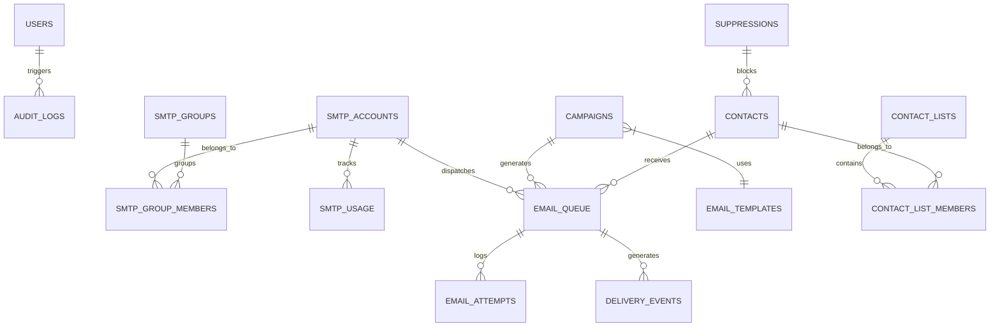
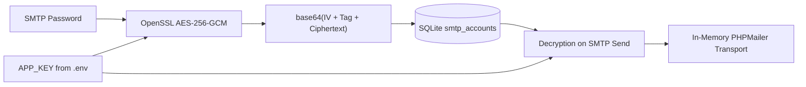
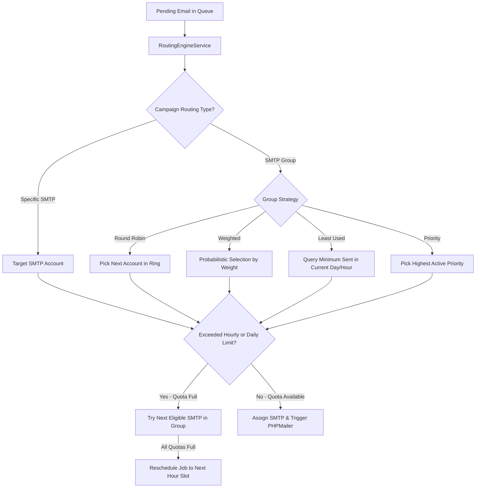
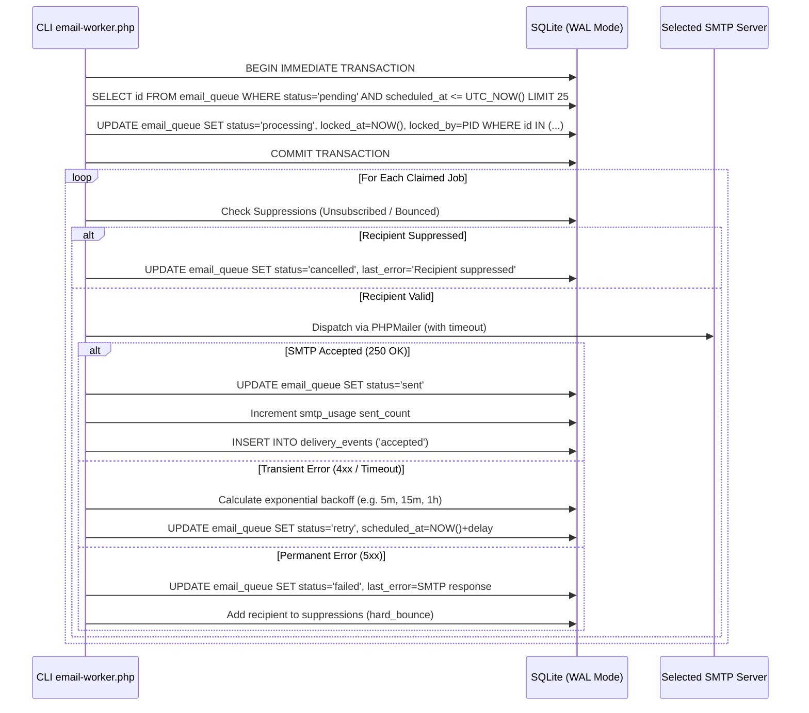
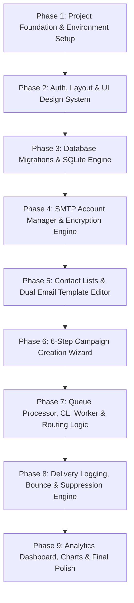

# MailMoll: Multi-SMTP Email Management System
## Architectural Blueprint & Phased Implementation Plan

---

### 1. Executive Summary & Core Principles

**MailMoll** is an enterprise-grade, self-hosted Multi-SMTP email management and dispatch dashboard designed for PHP 8.2+ with SQLite 3 (PDO). It serves organizations managing transactional communications and opted-in subscriber broadcasts across multiple SMTP service providers (e.g., Amazon SES, SendGrid, Mailgun, Postmark, Google Workspace, custom Postfix).

#### Strict Principles
1. **Compliance First**: Exclusively for opted-in contacts, automated transactional notifications, and authorized business messaging. Complete opt-out/unsubscribe RFC-8058 compliance.
2. **Quota & Rate-Limit Guard**: Strict enforcement of hourly and daily provider thresholds to protect sender reputation.
3. **Resilience & Fault Tolerance**: SQLite atomic locking (`BEGIN IMMEDIATE`), exponential backoff for transient errors, and immediate dead-lettering for permanent 5xx failures.
4. **Security by Default**: AES-256-GCM encryption at rest for all SMTP credentials, strict CSRF token validation, input sanitization, output escaping, and complete private directory protection.
5. **Zero Node.js Runtime**: Fully executable on standard Apache/cPanel shared or VPS hosting using native PHP, SQLite PDO, and CDN-delivered (with local fallback) modern UI libraries.

---

### 2. Architecture & Directory Hierarchy

The application adopts a decoupled **MVC + Service-Oriented Architecture** ensuring clear separation between HTTP requests, CLI background tasks, and business domain logic.

```
c:\xampp\htdocs\MailMoll\
│
├── composer.json               # PHP autoloader & dependencies (PHPMailer, etc.)
├── .env.example                # Sample environment variables & encryption keys
├── .env                        # Private app configuration (gitignored, web-blocked)
├── .htaccess                   # Root security protection (routes all traffic to /public)
│
├── public/                     # Public Web Root (only folder exposed to browser)
│   ├── .htaccess               # URL rewriting to index.php
│   ├── index.php               # Application front controller
│   └── assets/
│       ├── css/
│       │   ├── dashboard.css   # Custom SaaS theme & component styling
│       │   └── dark-mode.css   # Dark theme overrides
│       ├── js/
│       │   ├── app.js          # Core UI behaviors, notifications & AJAX helper
│       │   ├── smtp.js         # SMTP account manager & live connection tester
│       │   ├── campaign.js     # 6-step campaign wizard controller
│       │   └── analytics.js    # Chart.js visualization handlers
│       └── vendor/             # Local fallbacks for CDN scripts & icons
│
├── app/                        # Application Backend Core
│   ├── Controllers/            # HTTP Request Handlers
│   │   ├── AuthController.php
│   │   ├── DashboardController.php
│   │   ├── SmtpController.php
│   │   ├── CampaignController.php
│   │   ├── TemplateController.php
│   │   ├── ContactController.php
│   │   ├── QueueController.php
│   │   ├── LogController.php
│   │   ├── AnalyticsController.php
│   │   ├── SuppressionController.php
│   │   └── SettingsController.php
│   ├── Services/               # Core Business Engines
│   │   ├── SmtpManagerService.php    # Connection testing & PHPMailer transport
│   │   ├── RoutingEngineService.php  # Round-Robin, Weighted, Least-Used, Priority
│   │   ├── QueueWorkerService.php    # Atomic job claim & dispatch engine
│   │   ├── CampaignDispatcherService.php # Recipient resolver & queue generator
│   │   ├── CryptoService.php         # OpenSSL AES-256-GCM encryption helper
│   │   ├── RateLimiterService.php    # Hourly/daily sliding-window quota guard
│   │   └── BounceSuppressionService.php # RFC unsubscribe & bounce handling
│   ├── Models/                 # Database Entity Abstractions
│   │   ├── User.php
│   │   ├── SmtpAccount.php
│   │   ├── SmtpGroup.php
│   │   ├── Campaign.php
│   │   ├── Contact.php
│   │   ├── ContactList.php
│   │   ├── EmailTemplate.php
│   │   ├── QueueJob.php
│   │   └── DeliveryLog.php
│   ├── Middleware/             # Security & Request Filters
│   │   ├── AuthMiddleware.php
│   │   ├── CsrfMiddleware.php
│   │   └── SecurityHeadersMiddleware.php
│   ├── Helpers/                # Utility Functions
│   │   ├── View.php            # PHP template renderer with layout nesting
│   │   ├── Validator.php       # Form input validation engine
│   │   ├── Session.php         # Safe session & flash messages
│   │   └── Response.php        # JSON & redirection standardizer
│   └── Database/               # Schema & Migrations
│       ├── Connection.php      # PDO SQLite singleton with WAL mode & foreign keys
│       ├── Migration.php       # Schema execution & migration tracker
│       └── migrations/         # Versioned SQL migration files
│
├── config/                     # Configuration Arrays
│   ├── app.php                 # App name, URL, debug mode, timezone
│   ├── database.php            # SQLite file path & PDO attributes
│   └── security.php            # Encryption cipher, session parameters, rate limits
│
├── storage/                    # Non-Public Writable Storage (Web-Blocked)
│   ├── database/
│   │   └── mailmoll.sqlite     # SQLite production database file
│   ├── logs/
│   │   ├── app.log             # General app diagnostic logs
│   │   └── worker.log          # CLI queue worker execution logs
│   ├── backups/                # SQLite database snapshot backups
│   └── uploads/                # Contact CSV imports & temporary media
│
├── templates/                  # PHP Views (Clean separation of HTML & Logic)
│   ├── layouts/
│   │   ├── main.php            # Primary dashboard wrapper (Sidebar, Topbar, Footer)
│   │   └── auth.php            # Clean centered login/recovery layout
│   ├── dashboard/              # Overview widgets & charts
│   ├── smtp/                   # Accounts list, modal form, test modal, groups
│   ├── campaigns/              # Campaign list, 6-step creation wizard, view
│   ├── templates/              # Visual/HTML template editor & previews
│   ├── contacts/               # Contact lists, subscribers table, CSV import
│   ├── queue/                  # Queue monitor, retry actions, job inspector
│   ├── logs/                   # Delivery logs, attempt history, audit logs
│   ├── suppressions/           # Bounce & unsubscribe list manager
│   ├── analytics/              # Deep performance charts & comparison tables
│   └── settings/               # App settings, cron health, backup manager
│
├── routes/
│   ├── web.php                 # Browser UI routes
│   └── api.php                 # Internal AJAX/REST API routes
│
└── cron/                       # Scheduled CLI Background Tasks
    ├── email-worker.php        # Daemon or cron-triggered queue consumer
    └── cleanup.php             # Purge expired logs, prune locks & auto-backups
```

---

### 3. Database Architecture & SQLite Schema Design

SQLite 3 in **WAL (Write-Ahead Logging)** mode with `PRAGMA foreign_keys = ON;` and `PRAGMA synchronous = NORMAL;` delivers exceptional concurrent performance for web read operations while CLI workers process batches.



#### Detailed Table Specifications

1. **`users`**
   - `id` INTEGER PRIMARY KEY AUTOINCREMENT
   - `name` TEXT NOT NULL
   - `email` TEXT UNIQUE NOT NULL
   - `password_hash` TEXT NOT NULL
   - `role` TEXT NOT NULL DEFAULT 'admin' (admin/operator/viewer)
   - `status` TEXT NOT NULL DEFAULT 'active'
   - `last_login_at` DATETIME NULL
   - `created_at` DATETIME DEFAULT CURRENT_TIMESTAMP
   - `updated_at` DATETIME DEFAULT CURRENT_TIMESTAMP

2. **`smtp_accounts`**
   - `id` INTEGER PRIMARY KEY AUTOINCREMENT
   - `name` TEXT NOT NULL (e.g. "SendGrid Transactional 01")
   - `provider` TEXT NOT NULL (generic/sendgrid/ses/mailgun/google/custom)
   - `host` TEXT NOT NULL
   - `port` INTEGER NOT NULL DEFAULT 587
   - `encryption` TEXT NOT NULL DEFAULT 'tls' (tls/ssl/starttls/none)
   - `username` TEXT NOT NULL
   - `password_encrypted` TEXT NOT NULL (AES-256-GCM ciphertext + IV + tag)
   - `from_email` TEXT NOT NULL
   - `from_name` TEXT NOT NULL
   - `reply_to` TEXT NULL
   - `daily_limit` INTEGER NOT NULL DEFAULT 500
   - `hourly_limit` INTEGER NOT NULL DEFAULT 50
   - `priority` INTEGER NOT NULL DEFAULT 10 (Higher = preferred in priority routing)
   - `weight` INTEGER NOT NULL DEFAULT 1 (Used in weighted routing)
   - `status` TEXT NOT NULL DEFAULT 'active' (active/inactive/paused/failed)
   - `last_tested_at` DATETIME NULL
   - `last_test_result` TEXT NULL
   - `consecutive_failures` INTEGER NOT NULL DEFAULT 0
   - `created_at` DATETIME DEFAULT CURRENT_TIMESTAMP
   - `updated_at` DATETIME DEFAULT CURRENT_TIMESTAMP

3. **`smtp_groups`** & **`smtp_group_members`**
   - `smtp_groups`: `id`, `name`, `routing_strategy` (round_robin/weighted/least_used/priority), `created_at`
   - `smtp_group_members`: `id`, `group_id`, `smtp_account_id`, `created_at`

4. **`smtp_usage`** (Rolling quota tracker)
   - `id` INTEGER PRIMARY KEY AUTOINCREMENT
   - `smtp_account_id` INTEGER NOT NULL REFERENCES `smtp_accounts(id)` ON DELETE CASCADE
   - `year_month_day` TEXT NOT NULL (YYYY-MM-DD for indexing)
   - `hour_slot` INTEGER NOT NULL (0-23)
   - `sent_count` INTEGER NOT NULL DEFAULT 0
   - `failed_count` INTEGER NOT NULL DEFAULT 0
   - UNIQUE(`smtp_account_id`, `year_month_day`, `hour_slot`)

5. **`contact_lists`** & **`contacts`** & **`contact_list_members`**
   - `contact_lists`: `id`, `name`, `description`, `total_contacts`, `created_at`
   - `contacts`: `id`, `email` (indexed), `first_name`, `last_name`, `metadata_json`, `status` (subscribed/unsubscribed/bounced/complaint), `opt_in_at`, `opt_in_ip`, `created_at`
   - `contact_list_members`: `id`, `list_id`, `contact_id`, `created_at`, UNIQUE(`list_id`, `contact_id`)

6. **`email_templates`**
   - `id` INTEGER PRIMARY KEY AUTOINCREMENT
   - `name` TEXT NOT NULL
   - `subject_default` TEXT NULL
   - `body_html` TEXT NOT NULL
   - `body_plain` TEXT NULL
   - `tags` TEXT NULL
   - `created_at`, `updated_at`

7. **`campaigns`**
   - `id` INTEGER PRIMARY KEY AUTOINCREMENT
   - `title` TEXT NOT NULL
   - `subject` TEXT NOT NULL
   - `sender_name` TEXT NOT NULL
   - `sender_email` TEXT NOT NULL
   - `reply_to` TEXT NULL
   - `template_id` INTEGER NULL REFERENCES `email_templates(id)`
   - `routing_type` TEXT NOT NULL DEFAULT 'group' (group/single_smtp)
   - `smtp_group_id` INTEGER NULL REFERENCES `smtp_groups(id)`
   - `smtp_account_id` INTEGER NULL REFERENCES `smtp_accounts(id)`
   - `target_type` TEXT NOT NULL DEFAULT 'lists' (lists/all)
   - `target_list_ids` TEXT NULL (JSON array of list IDs)
   - `body_html` TEXT NOT NULL
   - `body_plain` TEXT NULL
   - `status` TEXT NOT NULL DEFAULT 'draft' (draft/scheduled/queued/processing/paused/completed/cancelled)
   - `scheduled_at` DATETIME NULL
   - `total_recipients` INTEGER NOT NULL DEFAULT 0
   - `sent_count` INTEGER NOT NULL DEFAULT 0
   - `failed_count` INTEGER NOT NULL DEFAULT 0
   - `started_at` DATETIME NULL
   - `completed_at` DATETIME NULL
   - `created_at`, `updated_at`

8. **`email_queue`** (The high-throughput core)
   - `id` INTEGER PRIMARY KEY AUTOINCREMENT
   - `campaign_id` INTEGER NULL REFERENCES `campaigns(id)` ON DELETE SET NULL
   - `contact_id` INTEGER NULL REFERENCES `contacts(id)` ON DELETE SET NULL
   - `recipient_email` TEXT NOT NULL
   - `recipient_name` TEXT NULL
   - `subject` TEXT NOT NULL
   - `body_html` TEXT NOT NULL
   - `body_plain` TEXT NULL
   - `headers_json` TEXT NULL
   - `selected_smtp_id` INTEGER NULL REFERENCES `smtp_accounts(id)`
   - `status` TEXT NOT NULL DEFAULT 'pending' (pending/processing/sent/retry/failed/cancelled)
   - `priority` INTEGER NOT NULL DEFAULT 5
   - `attempts` INTEGER NOT NULL DEFAULT 0
   - `max_attempts` INTEGER NOT NULL DEFAULT 3
   - `scheduled_at` DATETIME NOT NULL DEFAULT CURRENT_TIMESTAMP
   - `locked_at` DATETIME NULL
   - `locked_by` TEXT NULL (Worker process PID / UUID)
   - `last_error` TEXT NULL
   - `created_at` DATETIME DEFAULT CURRENT_TIMESTAMP
   - `updated_at` DATETIME DEFAULT CURRENT_TIMESTAMP
   - *Indexes*: `(status, scheduled_at, priority)`, `(campaign_id)`, `(recipient_email)`

9. **`email_attempts`** & **`delivery_events`**
   - Detailed attempt trace: `id`, `queue_id`, `smtp_account_id`, `attempt_number`, `status_code`, `response_text`, `duration_ms`, `attempted_at`.
   - High-level event ledger: `id`, `campaign_id`, `smtp_account_id`, `recipient_email`, `event_type` (accepted/rejected/bounced/unsubscribed), `meta_json`, `created_at`.

10. **`suppressions`** & **`unsubscribe_tokens`**
    - `suppressions`: `id`, `email` UNIQUE, `reason` (hard_bounce/complaint/unsubscribe/manual), `source_campaign_id`, `created_at`.
    - `unsubscribe_tokens`: `id`, `token` UNIQUE (cryptographic HMAC token), `email`, `campaign_id`, `created_at`, `used_at`.

11. **`audit_logs`** & **`app_settings`**
    - `audit_logs`: `id`, `user_id`, `action`, `resource_type`, `resource_id`, `ip_address`, `user_agent`, `details_json`, `created_at`.
    - `app_settings`: `key` PRIMARY KEY, `value` TEXT, `type` (string/integer/boolean/json), `updated_at`.

---

### 4. Security & Cryptographic Blueprint



1. **SMTP Credential Security at Rest**:
   - AES-256-GCM using PHP `openssl_encrypt()`.
   - Never stored in plaintext; never printed in logs; stripped completely (`unset($data['password'])`) before sending responses to API or client.
2. **CSRF Protection**:
   - Synchronizer Token Pattern with per-session token stored in PHP `$_SESSION['_csrf_token']`.
   - Verified on every POST, PUT, DELETE, and PATCH route by `CsrfMiddleware`.
3. **Session Hardening**:
   - `cookie_httponly = 1`, `cookie_secure` auto-detected for HTTPS, `cookie_samesite = 'Lax'`.
   - Session ID regenerated upon authentication (`session_regenerate_id(true)`).
4. **Storage & Database Protection**:
   - The `/storage` directory and `.env` file contain `.htaccess` denying all web requests (`Require all denied`).
   - In production, web document root is explicitly set to `/public`.

---

### 5. SMTP Routing Engine & Quota Architecture



- **Sliding-Window Hourly/Daily Guard**:
  Before each dispatch, MailMoll queries the `smtp_usage` table for the account in the current UTC date and hour.
  If `sent_count >= hourly_limit` or `daily_sent >= daily_limit`, the account is temporarily bypassed for the remainder of that window.
- **Circuit Breaker**:
  If an SMTP account encounters 3 consecutive authentication or connection timeouts, its status is automatically changed to `failed` and an alert is recorded in audit logs.

---

### 6. Queue Processing Engine & Worker Architecture



- **Execution Methods**:
  1. **Standard Cron (Recommended for shared hosting / cPanel)**:
     `* * * * * /usr/bin/php /path/to/MailMoll/cron/email-worker.php --max-jobs=100 --max-time=55`
     Executes safely every minute, finishes cleanly before the next minute invocation.
  2. **Daemon Mode (VPS / Systemd / Supervisor)**:
     `php cron/email-worker.php --daemon --sleep=3`
     Continuous loop with sleep intervals.

---

### 7. UI/UX Design System Specification

- **Color System**:
  - Primary Accent: `#6366F1` (Indigo Modern)
  - Secondary / Muted: `#64748B` (Slate Cool)
  - Dark Sidebar: `#111827` (Deep Obsidian Charcoal)
  - Light Canvas Background: `#F8FAFC` (Off-white clean surface)
  - Card Surfaces: `#FFFFFF` with `0 1px 3px 0 rgba(0, 0, 0, 0.08), 0 1px 2px -1px rgba(0, 0, 0, 0.06)`
- **Key UI Components**:
  - **Metric Stat Cards**: Clean iconography, delta pills, animated counters.
  - **Campaign Wizard**: 6 interactive steps with real-time validation, preview pane, and test send modal.
  - **Dual Email Template Editor**: Tabbed toggle between Quill.js (WYSIWYG visual rich text) and CodeMirror (raw HTML with syntax highlighting).
  - **DataTables**: Server-side capable or fast client-side tables with custom search, status badges, and bulk actions.
  - **Toast Notifications & SweetAlert2**: Non-blocking toast alerts for background saves and confirmation modals for dangerous actions (deletes, pauses).

---

### 8. Phased Implementation Roadmap



#### **Phase 1: Foundation & Dependencies**
- Initialize `composer.json` with `phpmailer/phpmailer`.
- Setup `.env` loader, `.htaccess` files for root and `/public`.
- Configure PSR-4 style autoloader for `App\`.

#### **Phase 2: Auth, Security Middleware & UI Shell**
- Implement `User` model, `Session` manager, `CsrfMiddleware`, and `AuthController`.
- Build the premium SaaS layout in `templates/layouts/main.php`:
  - Fixed dark sidebar with collapsible navigation.
  - Header with breadcrumbs, quick action buttons, user dropdown, theme switcher.
  - Responsive container with Bootstrap 5.3 and custom dashboard CSS.
- Build clean, modern Login page with validation and CSRF.

#### **Phase 3: SQLite Database & Migrations Engine**
- Build `Database/Connection.php` with WAL mode, foreign keys, and error mode exceptions.
- Implement migration runner executing numbered `.sql` migrations for all 17 tables.
- Seed initial admin user (`admin@mailmoll.local` / secure temporary password) and default app settings.

#### **Phase 4: SMTP Management & Encryption Engine**
- Create `CryptoService.php` with OpenSSL AES-256-GCM.
- Build SMTP Account Management:
  - Add / Edit / Delete SMTP accounts.
  - Live AJAX SMTP connection tester using PHPMailer with TLS/SSL debug reporting.
  - Daily & hourly quota tracker with progress bars.
  - SMTP Groups interface with routing strategy selectors.

#### **Phase 5: Contacts, CSV Import & Email Templates**
- Contact Lists and Contacts management.
- Chunked CSV contact importer with email validation and duplicate deduplication.
- Email Template builder:
  - CodeMirror for raw responsive HTML emails.
  - Quill.js for quick rich-text emails.
  - Live preview modal and placeholder tag insertion (`{{first_name}}`, `{{unsubscribe_url}}`, etc.).

#### **Phase 6: Campaign Management Wizard**
- Step-by-step Campaign Builder:
  1. Campaign Info (Title, subject, preheader)
  2. Sender Config (Select single SMTP or SMTP Group)
  3. Recipient Selection (Select lists or segments)
  4. Email Content (Select or customize template)
  5. Sending Schedule (Immediate or future Flatpickr datetime)
  6. Review & Confirm (Recipient count estimation, quota impact)
- Test email dispatch directly from the wizard before launch.

#### **Phase 7: Queue Engine, Routing Engine & CLI Worker**
- `RoutingEngineService`: Round-robin, weighted, least-used, priority algorithms.
- `QueueWorkerService`: Atomic SQLite job claim with transaction lock.
- Dispatcher invoking PHPMailer, handling 4xx transient retry delays and 5xx terminal failures.
- CLI worker scripts: `cron/email-worker.php` and `cron/cleanup.php`.

#### **Phase 8: Bounce Management, Suppressions & Unsubscribe Handler**
- Secure unsubscribe endpoint: `public/unsubscribe.php?token=...`
- Auto-suppression of bounced and unsubscribed addresses.
- Global suppression list view with manual add/delete and export.

#### **Phase 9: Analytics, System Settings & Documentation**
- Real-time Dashboard cards: Total sent, queued, failed, delivery acceptance rate.
- Chart.js visual charts: Daily dispatch volume, SMTP provider breakdown, failure distribution.
- Delivery log inspector with filterable status, recipient search, and modal error viewer.
- Full documentation: `README.md`, installation guide, cron job setup, Apache/cPanel deployment tips.

---

### 9. Recommended Next Action

Upon user review and confirmation, implementation will commence systematically starting with **Phase 1 (Foundation, Composer, Directory Structure)** and **Phase 2 (Auth & Design System)**.
